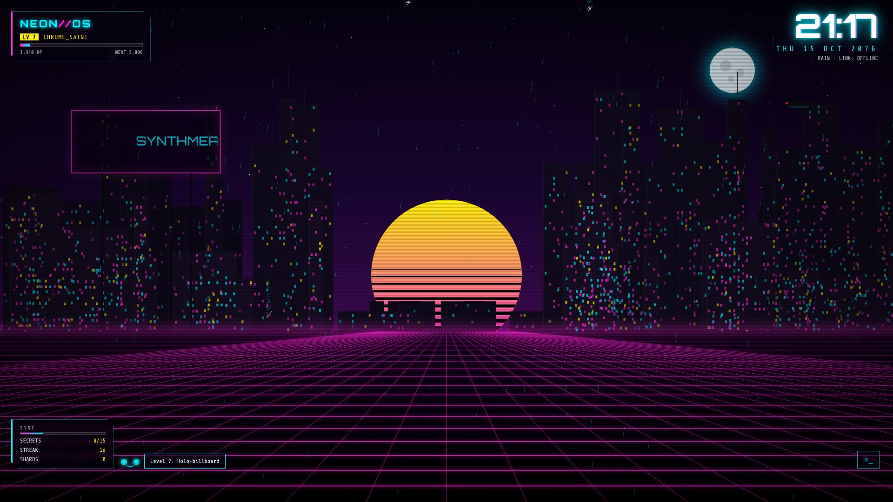

# NEON//OS — a cyberpunk theme for Windows 11 that levels up with you



An interactive, animated desktop: a living neon city as your wallpaper, a HUD that tracks **HP (Hack Points)**, ten levels that unlock new features, fifteen hidden secrets, and a background **Neural Link** that turns your real Windows navigation — opening apps, exploring folders, switching windows — into progress.

| Layer | What it does |
|---|---|
| `wallpaper/` | Interactive HTML5 wallpaper for [Lively Wallpaper](https://www.rocksdanister.com/lively/) (also runs in any browser) |
| `daemon/neural-link.ps1` | Local-only daemon: aggregates navigation activity → `http://localhost:47777/state` |
| `installer/` | Dark mode, neon accent on Start/taskbar/title bars, static wallpaper, Terminal scheme, daemon autostart — fully reversible |
| `terminal/neon-os.json` | Windows Terminal color scheme + "NEON//OS Shell" profile (fragment) |

## Install

```powershell
winget install rocksdanister.LivelyWallpaper        # interactive wallpaper host
git clone https://github.com/iancrediballs/cyber-windows
cd cyber-windows
powershell -NoProfile -ExecutionPolicy Bypass -File .\installer\install.ps1 -RestartExplorer
```

Options: `-Accent '#00F0FF'` (any hex), `-Port 47777`, `-SkipDaemon`, `-SkipWallpaper`, `-SkipTerminal`.

If the installer can't apply the Lively wallpaper automatically, drag `%LOCALAPPDATA%\NeonOS\NEON-OS-lively.zip` into Lively, then in **Lively → Settings → Wallpaper → Input** enable **Mouse** (and **Keyboard** for typed secrets / terminal). Audio reactivity uses Lively's built-in system audio capture.

Uninstall (restores every original setting from `%LOCALAPPDATA%\NeonOS\backup.json`):

```powershell
powershell -NoProfile -ExecutionPolicy Bypass -File .\installer\uninstall.ps1 -RestartExplorer   # add -Purge to delete Neural Link history
```

Preview without installing: open `wallpaper/index.html` in a browser. `?demo=5000` previews at a given HP on a throwaway save; `?nohud` hides the HUD.

## Progression

| LV | Title | HP | Unlocks |
|---|---|---|---|
| 1 | BOOT_SEQUENCE | 0 | Neon skyline, horizon grid, HUD |
| 2 | STREET_RAT | 100 | Weather system: acid rain, fog, storms (rolls with the date/hour) |
| 3 | GLITCH_RUNNER | 300 | Air traffic — click drones/cars to hack them |
| 4 | NETRUNNER | 650 | Terminal: <kbd>`</kbd> or the `>_` glyph |
| 5 | ICE_BREAKER | 1,200 | Breach Protocol minigame + ARASHI palette |
| 6 | DATA_GHOST | 2,000 | Audio-reactive skyline, equalizer, data streams |
| 7 | CHROME_SAINT | 3,200 | Holo-billboard (shows now-playing) + GHOST companion AI with hints |
| 8 | SYNTH_ORACLE | 5,000 | Lightning storms, 4-code breaches, TOXIC palette |
| 9 | VOID_WALKER | 7,500 | Orbital megastructure |
| 10 | LEGEND | 11,000 | AFTERLIFE gold palette, densest city |

The city evolves on its own too: sky tint follows the real time of day, weather re-rolls hourly, building density and lit windows grow with your level, and activity raises the **SYNC** meter (grid speed, glitch frequency, rain density).

### Earning HP

| Source | HP |
|---|---|
| Daily uplink | 10 + 5×streak (max 60) |
| Data shard (floating cube, ~every 90 s or via `scan`) | 15 |
| Hack a drone (LV3+) | 3 |
| Click the city | 1 (capped 60/hour) |
| Uptime | 2 per 5 min |
| Breach Protocol win | 60 + 2×seconds left |
| New terminal command | 5 |
| Secrets / achievements | 30 – 1,000 |
| **Neural Link** — window switch / app launch / new app / new folder | 1 / 3 / 25 / 8 |

Press <kbd>Tab</kbd> (or click the ID panel) for the **Codex**: levels, 18 achievements, secrets (with GHOST hints from LV7), and stats. <kbd>Esc</kbd> closes overlays.

## Secrets

Fifteen are hidden. No spoilers here — reach LV7 and GHOST starts leaking rumors, or try `scan` in the terminal at LV6+. (They live in `wallpaper/js/eggs.js` if you insist.)

## Neural Link & privacy

`neural-link.ps1` runs as your user, binds **localhost only**, and records aggregates: count of foreground-window switches and windowed app launches, the set of app **process names** seen, and SHA-256 **hashes** of Explorer folder paths (only the folder's leaf name is ever sent to the wallpaper, for the "SECTOR MAPPED" toast). No keystrokes, window titles, or file contents. State: `%LOCALAPPDATA%\NeonOS\link-state.json`.

Run it manually: `powershell -ExecutionPolicy Bypass -File .\daemon\neural-link.ps1 -Port 47777`. Check it: `curl http://localhost:47777/state`.

## Development

```bash
node tools/smoke.mjs               # headless Playwright test: levels, eggs, terminal, breach, Neural Link ingest
node tools/render-assets.mjs       # regenerate assets/wallpaper.png (4K), assets/preview.jpg, wallpaper/thumbnail.jpg
```

Wallpaper code is plain scripts (no build step, works from `file://` inside Lively): `state.js` (HP/levels/achievements/save) → `world.js` (canvas renderer) → `hud.js` → `eggs.js` → `breach.js` → `terminal.js` → `link.js` (daemon + Lively hooks) → `main.js` (input + loop).
